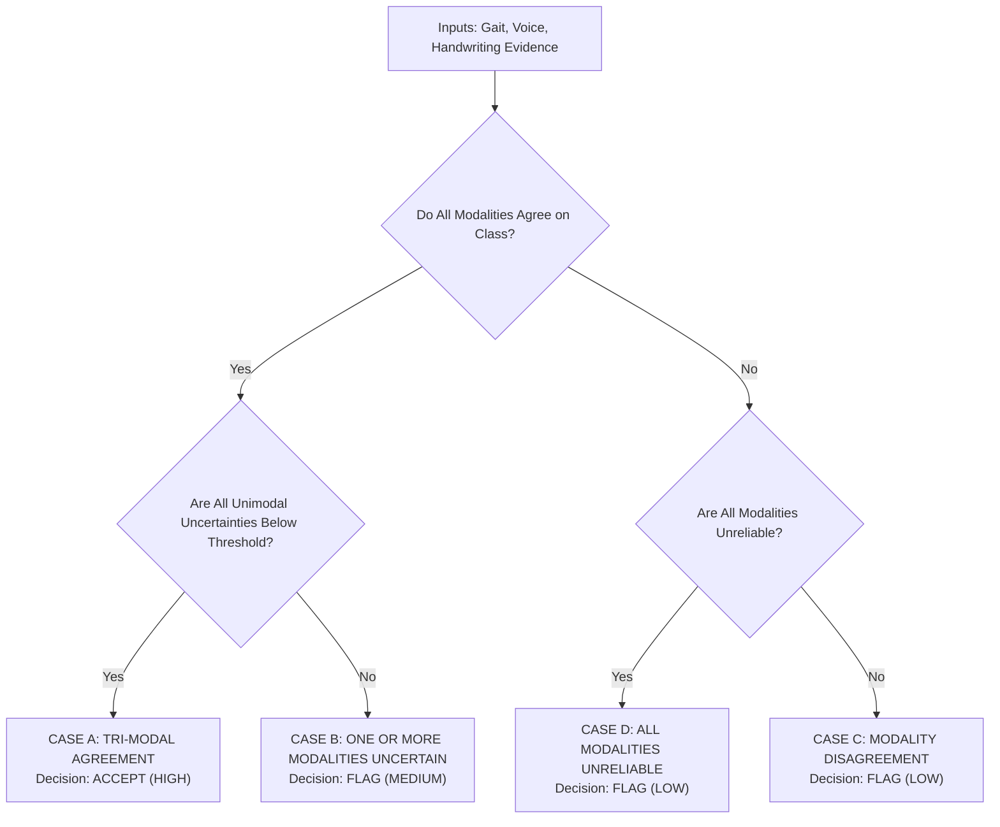

# 🧠 Parkinson's Disease Detection — Tri-Modal Reliability-Aware System

[](https://www.python.org/)
[](https://pytorch.org/)
[](https://huggingface.co/)
[](https://streamlit.io/)
[](LICENSE)

> **Research Focus:** *"Can Uncertainty Warn Us? Cohort-Shift Reliability of Parkinson's Disease Classifiers Across Voice, Handwriting, and Gait"*

An end-to-end, multimodal, reliability-aware clinical decision support system that detects **Parkinson's Disease (PD)** versus **Healthy Controls (HC)** from three non-invasive physiological biomarkers: **Gait dynamics**, **Vocal acoustics**, and **Handwriting kinematic drawings**.

---

## 📌 Table of Contents
1. [Overview & Research Motivation](#-overview--research-motivation)
2. [Tri-Modal Biomarker Architecture](#-tri-modal-biomarker-architecture)
3. [Uncertainty Quantification (UQ) Framework](#-uncertainty-quantification-uq-framework)
4. [Cross-Modal Reliability Fusion Policy](#-cross-modal-reliability-fusion-policy)
5. [Installation & Setup](#-installation--setup)
6. [Dataset Acquisition & Preparation](#-dataset-acquisition--preparation)
7. [Training & Evaluation Pipelines](#-training--evaluation-pipelines)
8. [Unified Multimodal CLI](#-unified-multimodal-cli)
9. [Interactive Streamlit Demo App](#-interactive-streamlit-demo-app)
10. [Repository Structure](#-repository-structure)
11. [Clinical & Ethical Disclaimer](#-clinical--ethical-disclaimer)

---

## 🔬 Overview & Research Motivation

Standard deep learning classifiers in medical diagnostics output uncalibrated, overconfident softmax probabilities. When exposed to **sensor degradation**, **acoustic noise**, or **cohort distribution shifts** (different clinical sites, acquisition hardware, or patient demographics), models often make catastrophic errors with high confidence.

This project implements an **Evidential Deep Learning (EDL)** framework combined with **Subject-Level Split Conformal Prediction** and **Deep Ensembles** to equip models with the ability to say:
> *"I do not know — this prediction is uncertain and must be reviewed by a neurologist."*

```
   ┌─────────────────────────────────────────────────────────────┐
   │                  INPUT BIOMARKERS                           │
   │   🦶 Gait (VGRF)      🎤 Voice (Audio)    ✍️ Handwriting    │
   └──────────┬───────────────────┬───────────────────┬──────────┘
              ▼                   ▼                   ▼
       1D-CNN + BiLSTM         Wav2Vec2        Vision Transformer
       Evidential Head      Evidential Head     Evidential Head
              │                   │                   │
              ▼                   ▼                   ▼
      Dirichlet Vacuity   Predictive Entropy   Dirichlet Vacuity
      Conformal Sets       Conformal Sets      Conformal Sets
      Ensemble (M=5)       Ensemble (M=5)      Ensemble (M=5)
              │                   │                   │
              └───────────────────┼───────────────────┘
                                  ▼
               ┌─────────────────────────────────────┐
               │    CROSS-MODAL RELIABILITY ENGINE   │
               │   Decision Cases: A, B, C, D, E     │
               └──────────────────┬──────────────────┘
                                  ▼
                    ┌───────────────────────────┐
                    │     CLINICAL DECISION     │
                    │   [ACCEPT]   vs   [FLAG]  │
                    └───────────────────────────┘
```

---

## 🧬 Tri-Modal Biomarker Architecture

| Modality | Input Specification | Model Architecture | Primary Dataset |
|---|---|---|---|
| **🦶 Gait** | 16-channel continuous Vertical Ground Reaction Force (VGRF) at 100 Hz | **1D-CNN + Bidirectional LSTM** with Evidential Head | PhysioNet Gait in PD Database (Ga, Ju, Si cohorts; 165 subjects) |
| **🎤 Voice** | Single-channel 16 kHz WAV audio chunks (sustained vowel / reading) | **Wav2Vec2** self-supervised representations with Evidential Head | MDVR-KCL Speech Cohort |
| **✍️ Handwriting** | Static spiral and meander kinematic drawing scans ($224 \times 224$ RGB) | **Vision Transformer (ViT)** & 4-stage **CNN** baseline | NewHandPD Dataset |

---

## 📐 Uncertainty Quantification (UQ) Framework

All three modalities share the **Dirichlet Subjective Logic** formulation:

### 1. Evidential Deep Learning (EDL)
Instead of conventional softmax, the network parameterizes a Dirichlet probability density over class probabilities:
$$e_k = \text{Softplus}(z_k) \ge 0, \quad \alpha_k = e_k + 1, \quad S = \sum_{k=1}^K \alpha_k$$
- **Class Probabilities:** $p_k = \frac{\alpha_k}{S}$
- **Dirichlet Vacuity (Uncertainty):** $u = \frac{K}{S}$ where $u \in (0, 1]$
- **Loss Function:**
$$\mathcal{L}(\Theta) = \mathcal{L}_{\text{ACE}}(y, \alpha) + \lambda_t \mathcal{L}_{\text{KL}}(\tilde{\alpha})$$
where $\lambda_t = \min\left(1.0, \frac{t}{t_{\text{max}}}\right)$ anneals the KL divergence penalty on misleading evidence.

### 2. Multi-Method Uncertainty Comparison
The framework benchmarks and compares six distinct uncertainty paradigms:
1. **Evidential Deep Learning (EDL):** Single forward pass closed-form vacuity and aleatoric/epistemic decomposition.
2. **Deep Ensembles ($M=5$):** Multi-model variance and agreement score across independent initializations.
3. **Monte Carlo (MC) Dropout ($N=30$):** Test-time stochastic dropout sampling to capture epistemic entropy.
4. **Split Conformal Prediction:** Finite-sample coverage guarantee ($1 - \alpha = 90\%$) with non-conformity calibration.
5. **Temperature Scaling:** Post-hoc Platt scaling optimization on held-out validation logits.
6. **Calibration Baselines:** Expected Calibration Error (ECE) and Brier score tracking.

---

## ⚖️ Cross-Modal Reliability Fusion Policy

The unified decision engine evaluates unimodal evidence against 5 clinical cases:



---

## 💻 Installation & Setup

### 1. Clone the Repository
```bash
git clone https://github.com/Mathesh07/parkinson-s-disease-detection.git
cd parkinson-s-disease-detection
```

### 2. Set Up Virtual Environment & Dependencies
```bash
python -m venv venv
# Linux / macOS:
source venv/bin/activate
# Windows:
.\venv\Scripts\activate

pip install -r requirements.txt
pip install -e .
```

---

## 📊 Dataset Acquisition & Preparation

### 1. Gait Dataset (PhysioNet)
- Download from PhysioNet: [Gait in Parkinson's Disease (v1.0.0)](https://physionet.org/content/gaitpdb/1.0.0/)
- Place extracted files into `Gait/gait-in-parkinsons-disease-1.0.0/`

### 2. Voice Dataset (MDVR-KCL)
- Download the King's College London MDVR audio recordings.
- Place audio files into `Voice/26-29_09_2017_KCL/`

### 3. Handwriting Dataset (NewHandPD)
- Download the spiral and meander image folders (`HealthySpiral`, `PatientSpiral`, etc.) and CSV metadata (`NewSpiral.csv`, `NewMeander.csv`).
- Place into `Handwriting/NewHandPD/`

---

## 🚀 Training & Evaluation Pipelines

### Gait Modality
```bash
# Standard training & evaluation
python Gait/train.py
python Gait/evaluate.py

# Evidential training & Leave-One-Cohort-Out (LOCO)
python Gait/train_evidential.py
python Gait/evaluate_evidential.py
python Gait/experiments/leave_one_cohort_out.py
```

### Voice Modality
```bash
# Evidential Wav2Vec2 training
python Voice/train_evidential.py
python Voice/evaluate_evidential.py

# Uncertainty experiments
python Voice/deep_ensemble.py
python Voice/mc_dropout.py
python Voice/conformal_prediction.py
```

### Handwriting Modality
```bash
# Evidential ViT training
python Handwriting/train_evidential.py
python Handwriting/evaluate_evidential.py

# Handwriting parity experiments
python Handwriting/experiments/mc_dropout.py
python Handwriting/experiments/conformal_prediction.py
python Handwriting/experiments/corruption_shift.py
python Handwriting/experiments/deep_ensemble.py
```

---

## 🖥️ Unified Multimodal CLI

Run unified tri-modal inference across raw files in one command:

```bash
python predict_multimodal.py \
  --gait Gait/sample_gait.txt \
  --voice Voice/sample_audio.wav \
  --handwriting Handwriting/sample_spiral.png
```

For JSON output:
```bash
python predict_multimodal.py --voice sample.wav --handwriting sample.png --json
```

---

## 🌐 Interactive Streamlit Demo App

Launch the full dark-themed research dashboard with 4 views:
```bash
streamlit run demo/app.py
```

**Demo Features:**
1. **🔍 Analyzer View:** Upload raw patient files or test 4 pre-set clinical demonstration scenarios (Strong Agreement, Modality Conflict, Evidential Vacuity, Healthy Consensus).
2. **🏗️ Architecture View:** Interactive flowcharts of data processing and evidential heads.
3. **💡 Why Reliability View:** Comparison of overconfident traditional AI vs. reliability-aware clinical AI.
4. **📊 Evidence & Dashboards:** ROC curves, calibration curves, confusion matrices, and corruption shift graphs.

---

## 📁 Repository Structure

```
parkinson-s-disease-detection/
├── Gait/                       # Gait Modality (1D-CNN + BiLSTM)
│   ├── config.py               # Sampling rate, channels, hyperparameters
│   ├── dataset.py              # Subject-level zero-leakage DataLoader
│   ├── preprocessing.py        # Normalization & manifest builder
│   ├── model.py                # 1D-CNN + BiLSTM + EvidentialHead
│   ├── train_evidential.py     # Dirichlet evidential training
│   ├── evaluate_evidential.py  # Subject-level evidential evaluation
│   ├── experiments/            # LOCO, Deep Ensemble, MC Dropout, Conformal
│   └── tests/                  # 9 unit & integration test suites
├── Voice/                      # Voice Modality (Wav2Vec2)
│   ├── config.py               # Audio chunking, model config
│   ├── dataset.py              # 16kHz resampling & chunking
│   ├── model.py                # Wav2Vec2 + EvidentialHead
│   ├── predict.py              # Standalone CLI voice inference
│   ├── reliability_engine.py   # Voice multi-signal decision engine
│   └── tests/                  # 14 unit & integration test suites
├── Handwriting/                # Handwriting Modality (ViT + CNN)
│   ├── config.py               # Image size, learning rates
│   ├── dataset.py              # Stratified patient-level grouping
│   ├── model.py                # ViT & CNN with Evidential Heads
│   ├── predict.py              # Standalone CLI handwriting inference
│   ├── reliability_engine.py   # Handwriting decision & conformal engine
│   ├── experiments/            # MC Dropout, Conformal, Corruption, Ensemble
│   └── tests/                  # Handwriting unit test suite
├── demo/                       # Interactive Streamlit Demo Application
│   ├── app.py                  # Main application entry point
│   └── components/             # Analyzer, Architecture, Educational, Evidence views
├── cross_modal_reliability.py  # Tri-Modal Cross-Modal Fusion Engine
├── evidential.py               # Shared Dirichlet mathematics & ACE loss
├── multimodal_pipeline.py      # Unified end-to-end multimodal pipeline
├── predict_multimodal.py       # Unified CLI tool
├── requirements.txt            # Dependency specification
└── pyproject.toml              # Build & packaging configuration
```

---

## ⚕️ Clinical & Ethical Disclaimer

> [!CAUTION]
> **Research Prototype Only:** This software is an academic research system designed to evaluate machine learning reliability, uncertainty estimation, and distribution shift in digital biomarkers. It is **NOT** a certified medical diagnostic device and should **NEVER** be used as a standalone substitute for professional clinical diagnosis by certified neurologists.